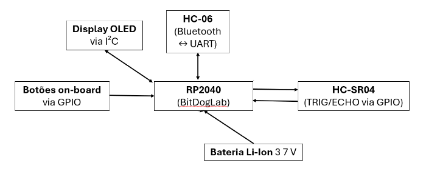
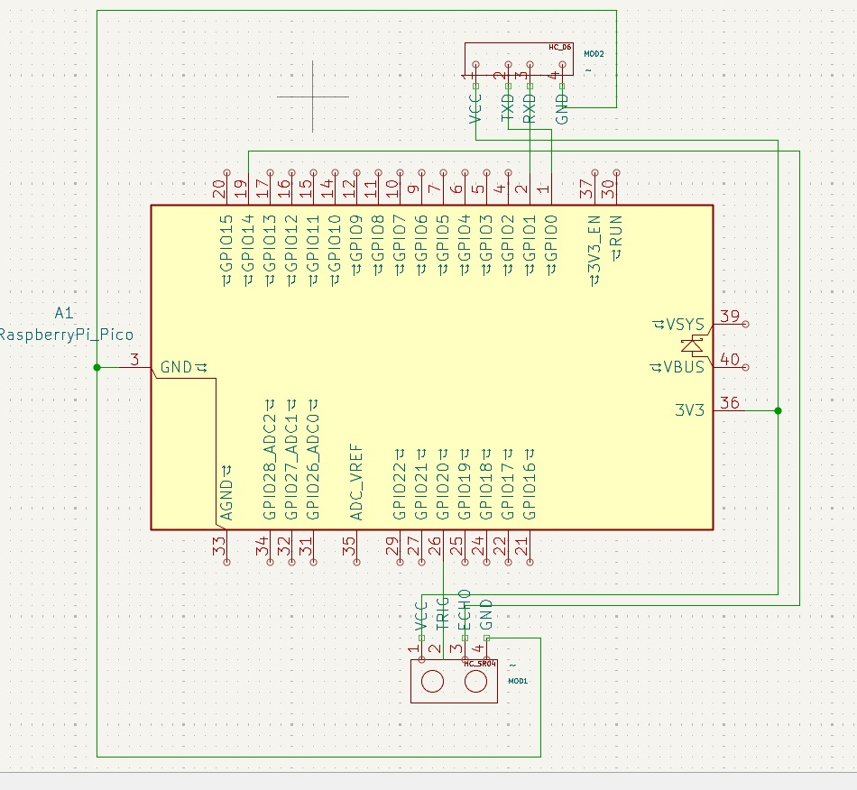

# Régua Inteligente - Raspberry Pi Pico

Um sistema completo de medição de distância ultrassônica implementado para o
microcontrolador Raspberry Pi Pico, utilizando sensor HCSR04, display OLED,
comunicação Bluetooth e interface com botões.

## 📏 Descrição do Sistema

O sistema implementa um medidor de distância ultrassônico que utiliza o sensor
HCSR04 para realizar medições precisas de distância, exibindo os resultados em
um display OLED e transmitindo os dados via Bluetooth para dispositivos móveis
ou computadores.

## ✨ Funcionalidades

-   **Medição Ultrassônica**: Utiliza sensor HCSR04 para medições de 2cm a 400cm
-   **Display OLED**: Exibe resultados em tempo real em display SSD1306 128x64
-   **Comunicação Bluetooth**: Transmite dados via módulo HC-05/06 usando UART
-   **Interface Simples**: Controle através de botão físico para ativar medições
-   **Precisão**: Medições com precisão de centímetros usando velocidade do som
-   **Feedback Visual**: Exibição clara da distância medida no display
-   **Transmissão de Dados**: Envio automático dos dados via Bluetooth

## 🔧 Componentes de _Hardware_

### _On-board_
-   **Raspberry Pi Pico**
-   **Display OLED SSD1306** (128x64 pixels, I2C)
-   **Botão Push** (para ativar medições)

### _Off-board_
-   **Sensor Ultrassônico HCSR04** (2cm - 400cm de alcance)
-   **Módulo Bluetooth HC-05/06** (UART)

### 🔧 Detalhes Técnicos

-   **Linguagem**: C (SDK Raspberry Pi Pico)
-   **Display**: SSD1306 OLED via I2C (400kHz)
-   **Sensor**: HCSR04 ultrassônico com precisão de centímetros
-   **Comunicação**: UART 9600 baud para Bluetooth
-   **Tratamento de Entradas**: Leitura de botão via interrupção GPIO com detecção de borda
-   **Interrupções**: ISR para botão A com debounce de 50ms
-   **Timing**: Medição baseada em tempo de eco do ultrassom

### 📊 Especificações do Sensor (Componente Central)

O sistema utiliza o sensor HCSR04 com as seguintes características:
- **Alcance**: 2cm a 400cm
- **Precisão**: ±3mm
- **Ângulo de medição**: 15°
- **Frequência**: 40kHz
- **Tempo de resposta**: <100ms
- **Fórmula de cálculo**: distância = tempo_eco_us / 58.0

### 🏗️ Arquitetura do Sistema

### Diagrama de Blocos



**Componentes Principais:**

- **Microcontrolador**: Raspberry Pi Pico (RP2040)
- **Sensor**: HCSR04 ultrassônico via GPIO
- **Display**: OLED SSD1306 via I2C
- **Comunicação**: Módulo Bluetooth HC-05/06 via UART
- **Interface**: Botão A via GPIO com pull-up interno

**Conexões entre RP2040 e Periféricos**
- **GPIO 2-3**: Display OLED (Módulo I2C1 - SDA/SCL)
- **GPIO 5**: Botão A (entrada com pull-up)
- **GPIO 14**: Sensor HCSR04 ECHO
- **GPIO 20**: Sensor HCSR04 TRIG
- **GPIO 0-1**: Bluetooth (Módulo UART0 - TX/RX)

## 🗺️ Fluxo de Controle Principal (Pseudo-código)

```pseudocode
🔧 INICIAR:
    Configurar I2C para display OLED
    Configurar GPIO para sensor HCSR04
    Configurar UART para Bluetooth
    Configurar botão A com pull-up e interrupção GPIO
    Mostrar mensagem de inicialização

🔄 ENQUANTO sistema_ativo:
    1️⃣ Verificar flag de interrupção do botão A
    
    2️⃣ SE flag_a foi setada pela ISR (borda de subida):
        a) 🔬 ENVIO DO PULSO: Enviar pulso de 10μs no pino TRIG
        b) 🔬 DETECÇÃO DO ECO: Aguardar sinal ECHO subir (início da reflexão)
        c) 🔬 MEDIÇÃO DO TEMPO: Aguardar sinal ECHO descer (fim do eco)
        d) 🔬 CÁLCULO DA DISTÂNCIA: Calcular tempo de eco e aplicar fórmula:
           - tempo_eco_us = duração do sinal ECHO
           - distância = tempo_eco_us / 58.0 (baseado na velocidade do som)
    
    3️⃣ 🔬 EXIBIÇÃO: Mostrar resultado no display:
        a) Limpar buffer do display
        b) Mostrar "HC-SR04" no display
        c) Mostrar "Dist: X.X cm" no display
        d) Atualizar display OLED
    
    4️⃣ 🔬 TRANSMISSÃO: Enviar dados via Bluetooth:
        a) Formatar mensagem: "Dist: X.XX cm\r\n"
        b) Enviar via UART para módulo Bluetooth
    
    5️⃣ Aguardar próximo pressionamento (delay 50ms)

🏁 FIM:
    Sistema continua rodando indefinidamente
```
## Implementação Física de _Hardware_ _Off-line_



## Interface com Mundo Físico

### Entradas

- **Botão A (GPIO 5)**: Botão físico para ativar medições de distância
  - Pressionar para iniciar uma nova medição
  - **Interrupção GPIO** configurada para borda de subida
  - **ISR (Interrupt Service Routine)** com debounce de 50ms
  - Pull-up interno ativado para evitar flutuações

- **Sensor HCSR04 ECHO (GPIO 14)**: Sinal de retorno do sensor ultrassônico
  - Recebe eco do pulso ultrassônico
  - Sinal digital HIGH durante o tempo de eco
  - Usado para calcular distância baseada no tempo de propagação

### Saídas

- **Display OLED SSD1306 (I2C - GPIO 2/3)**: Interface visual principal
  - Exibe título "HC-SR04" no topo
  - Mostra distância medida em formato "Dist: X.X cm"
  - Atualização em tempo real após cada medição
  - Resolução 128x64 pixels

- **Sensor HCSR04 TRIG (GPIO 20)**: Pulso de ativação do sensor
  - Envia pulso de 10μs para iniciar medição
  - Ativado automaticamente quando botão A é pressionado
  - Frequência de 40kHz para medição ultrassônica

- **Módulo Bluetooth HC-05/06 (UART - GPIO 0/1)**: Comunicação sem fio
  - Transmite dados de distância via UART (9600 baud)
  - Formato: "Dist: X.XX cm\r\n"
  - Permite monitoramento remoto via dispositivos móveis

### Guia de Uso

#### 🚀 Inicialização do Sistema

1. **Ligue o sistema**: Conecte a alimentação USB à Raspberry Pi Pico
2. **Aguarde inicialização**: O display mostrará a mensagem de inicialização
3. **Verifique conexões**: Confirme que o sensor HCSR04 e display estão conectados
4. **Sistema pronto**: O display mostrará "HC-SR04" indicando que está operacional

#### 📏 Realizando Medições

1. **Posicione o sensor**: Aponte o sensor HCSR04 na direção do objeto a ser medido
2. **Pressione o botão A**: Mantenha pressionado por um momento e solte
3. **Aguarde a medição**: O sistema enviará um pulso ultrassônico e aguardará o eco
4. **Visualize o resultado**: A distância aparecerá no display no formato "Dist: X.X cm"
5. **Dados transmitidos**: Os dados são automaticamente enviados via Bluetooth

#### ⚠️ Dicas Importantes

- **Distância mínima**: 2cm (objetos muito próximos podem não ser detectados)
- **Distância máxima**: 400cm (objetos muito distantes podem não retornar eco)
- **Superfícies ideais**: Materiais sólidos e planos refletem melhor o ultrassom
- **Evite obstáculos**: Certifique-se de que não há objetos entre o sensor e o alvo
- **Temperatura ambiente**: A precisão pode variar com mudanças de temperatura
- **Superfícies problemáticas**: Vidro, espuma e tecidos podem absorver o ultrassom

#### 🔧 Resolução de Problemas

- **"Dist: 0.0 cm"**: Objeto fora do alcance ou sem eco retornado
- **Valores inconsistentes**: Verifique se há obstáculos ou superfícies irregulares
- **Display não atualiza**: Verifique conexões I2C do display
- **Bluetooth não transmite**: Confirme conexões UART e configuração do módulo
- **Botão não responde**: Verifique conexão GPIO 5 e pull-up interno

#### 📱 Monitoramento via Bluetooth

1. **Pareie o dispositivo**: Conecte seu smartphone/tablet ao módulo Bluetooth
2. **Abra aplicativo serial**: Use um app como "Serial Bluetooth Terminal"
3. **Configure conexão**: 9600 baud
4. **Monitore dados**: Receba medições em tempo real no formato "Dist: X.XX cm"

## 🚀 Instalação e Configuração

### Pré-requisitos

- **Visual Studio Code** com as seguintes extensões:
  - **CMake Tools** (Microsoft)
  - **Raspberry Pi Pico** (Wokwi)
  - **Cortex-Debug** (marus25)
- **DAP Link** para carregamento (_flashing_) e depuração (_debugging_)
- **Raspberry Pi Pico SDK** instalado
- [**Biblioteca SSD1306**](https://github.com/daschr/pico-ssd1306): Driver para display [`OLED SSD1306`](inc)
  - Inclui: `ssd1306.h`, `ssd1306_i2c.h`, `ssd1306_i2c.c`, `ssd1306_font.h`

### 1. Clonar o Repositório

```bash
git clone https://gitlab.unicamp.br/EA801_2025S2/tA/G4/P2.git
cd P2
```

### 2. Configurar e Executar no VSCode

1. **Abrir o projeto no VSCode**:
   ```bash
   code .
   ```

2. **Importar o projeto na extensão Raspberry Pi Pico**:
   - Vá para a extensão "Raspberry Pi Pico" no VSCode
   - Clique em "Import Project" ou "Importar Projeto"
   - Selecione a pasta do projeto clonado

3. **Conectar o _hardware_**:
   - Conecte o DAP Link à aos pinos DEBUG da Raspberry Pi Pico e a uma porta USB do computador
   - Certifique-se de que a Pico está conectada via mini-USB a outra porta USB do computador

4. **Compilar e Debuggar**:
   - Na extensão Raspberry Pi Pico, clique em "Debug" ou "Debugar"
   - A extensão automaticamente:
     - Compila o projeto
     - Faz o flashing para a Pico
     - Inicia a sessão de debugging
   - Use breakpoints e inspeção de variáveis conforme necessário

### 3. Instalação Simples (Para Usuários Finais)

Se você apenas quer usar a régua digital sem desenvolver ou depurar:

1. **Baixar o firmware**:
   - Acesse a pasta `build/` do projeto
   - Localize o arquivo [`main.uf2`](build\main.uf2)

2. **Carregar na Raspberry Pi Pico**:
   - Mantenha pressionado o botão BOOTSEL da Pico
   - Conecte a Pico via USB ao computador (mantendo BOOTSEL pressionado)
   - Solte o botão BOOTSEL - a Pico aparecerá como unidade USB "RPI-RP2"
   - Copie o arquivo `main.uf2` para a unidade RPI-RP2
   - A Pico reiniciará automaticamente e executará o firmware

3. **Conectar o hardware**:
   - Conecte o sensor HCSR04, display OLED e módulo Bluetooth conforme o esquemático
   - O sistema estará pronto para uso imediatamente

## 🧪 Testes de Validação

Foram conduzidos os seguintes procedimentos de teste para validar o funcionamento do sistema:

### **Teste do Sensor HCSR04**
- Posicionamento do sensor a distâncias conhecidas (5cm, 10cm, 25cm, 50cm, 100cm)
- Execução de 10 medições consecutivas em cada distância
- Comparação dos valores medidos com distâncias reais usando régua física

### **Teste do Display OLED**
- Verificação da inicialização e exibição do título "HC-SR04"
- Teste de formatação dos valores numéricos (inteiros e decimais)
- Validação da atualização em tempo real após cada medição
- Teste de exibição com valores extremos (mínimo e máximo)

### **Teste da Comunicação Bluetooth**
- Configuração de aplicativo serial (9600 baud)
- Transmissão de dados após cada medição
- Verificação do formato da mensagem "Dist: X.XX cm\r\n"

### **Teste do Botão A**
- Teste de detecção de interrupção GPIO (borda de subida)
- Validação do debounce na ISR (50ms)
- Teste de flag global entre ISR e loop principal

Todos os testes foram concluídos com resultado satisfatório

## ⚠️ Limitações

-   O sensor HCSR04 tem alcance limitado de 2cm a 400cm
-   A precisão pode variar com temperatura e umidade do ambiente
-   O sistema não possui calibração automática para diferentes condições
-   Não há salvamento de histórico de medições
-   Não há tratamento de erros para medições fora do alcance

## 🤝 Autores

Este projeto foi desenvolvido por **Beatriz Moreira** e **Gustavo de Melo**   
como parte da disciplina **EA801** (turma A) na **FEEC** da **Unicamp**.

## 📄 Licença

Este projeto é parte de um trabalho acadêmico da disciplina EA801 - 
Sistemas Embarcados da Unicamp.

---

**Régua Inteligente na sua Raspberry Pi Pico!** 📏✨
